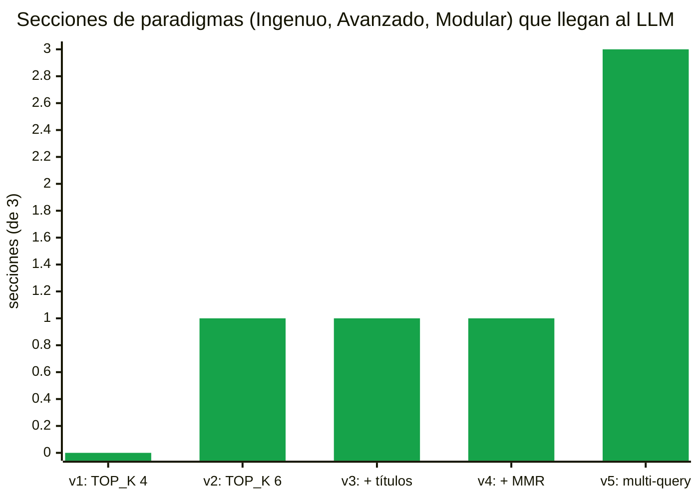
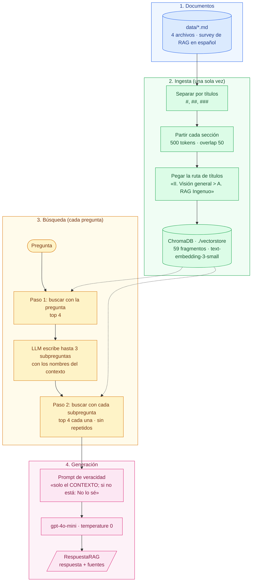
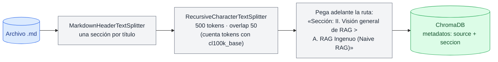
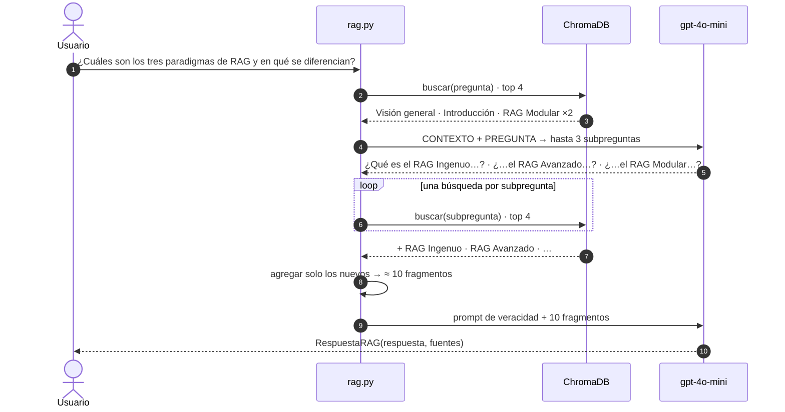
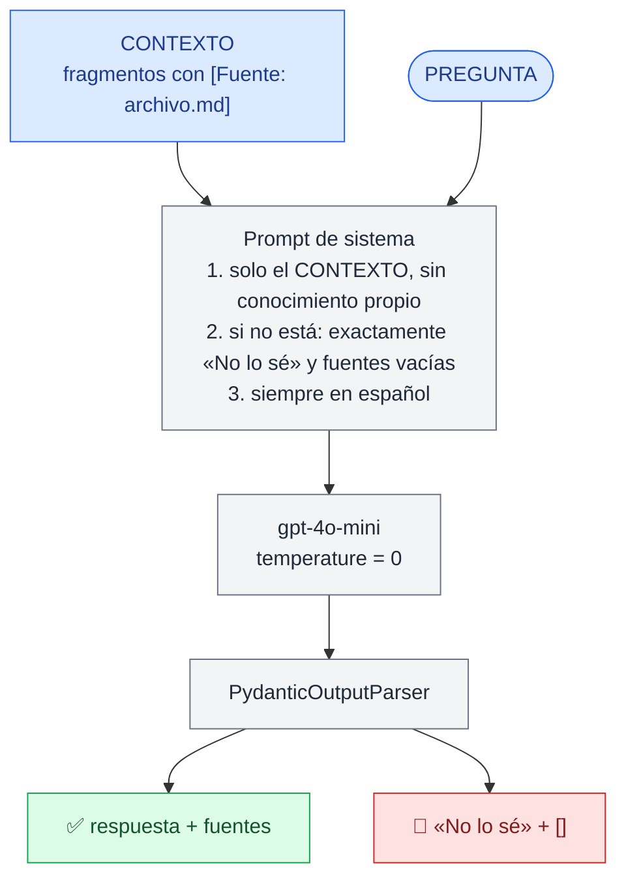
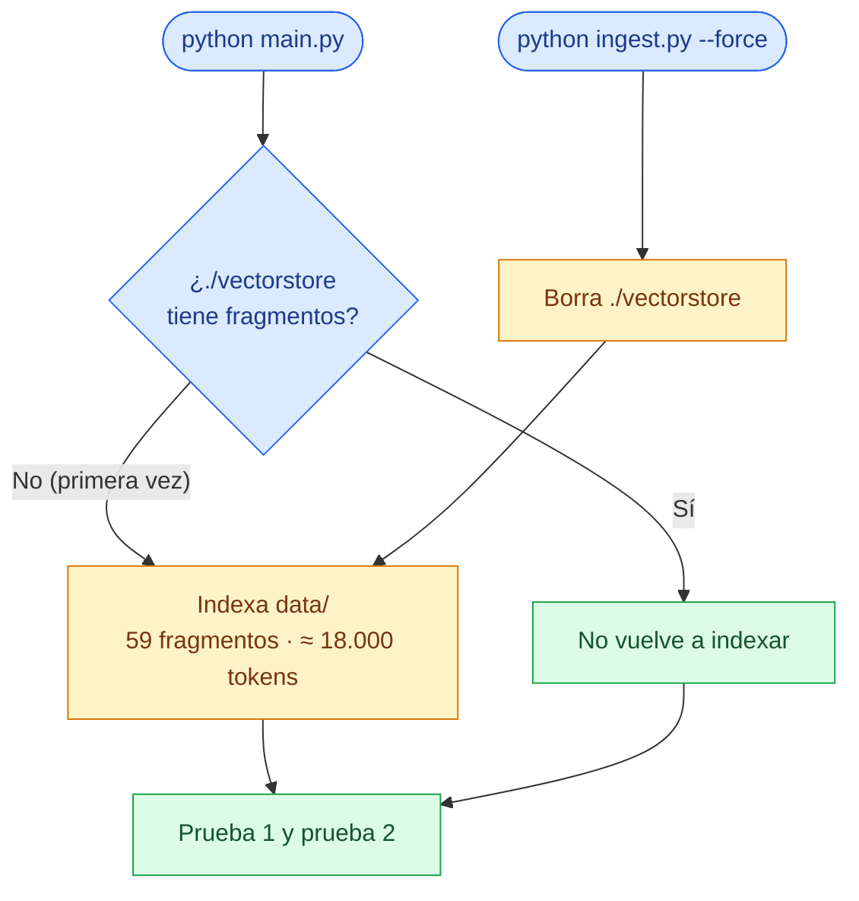
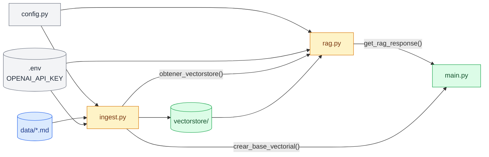

# Sistema RAG local con LangChain y ChromaDB

**Un asistente que responde preguntas sobre un paper usando solo lo que dice el paper, y que dice "No lo sé" cuando la respuesta no está.**

Un sistema de **Retrieval-Augmented Generation (RAG)** que corre en tu máquina: indexa el survey *"Retrieval-Augmented Generation for Large Language Models: A Survey"* (Gao et al., 2024), traducido al español, en una base vectorial local (ChromaDB), y responde con `gpt-4o-mini` citando el archivo del que sacó cada dato.

**La consigna, en una línea:** armar un RAG local con LangChain y ChromaDB, con una función asíncrona `get_rag_response(query)` que devuelva un modelo Pydantic, y probarlo con una pregunta que está en los documentos y una pregunta trampa que no está.

| | |
|---|---|
| **Tipo** | Pre-entrega 3 |
| **Autor** | Rodolfo Javier Berrone |
| **Año** | 2026 |
| **Documentos** | El survey de RAG de Gao et al. (arXiv:2312.10997v5), traducido al español en 4 archivos Markdown |
| **Estado** | Las dos pruebas pasan de forma estable (3 de 3 corridas) |


## Contenido

- [El proyecto en una imagen](#el-proyecto-en-una-imagen)
- [Cómo funciona](#cómo-funciona)
- [1. Los documentos](#1-los-documentos)
- [2. Ingesta: chunking por títulos](#2-ingesta-chunking-por-títulos)
- [3. Búsqueda: multi-query en dos pasos](#3-búsqueda-multi-query-en-dos-pasos)
- [4. Generación: el prompt como filtro de veracidad](#4-generación-el-prompt-como-filtro-de-veracidad)
- [5. Pruebas](#5-pruebas)
- [Qué aprendimos](#qué-aprendimos)
- [Costos](#costos)
- [Reproducir](#reproducir)
- [Estructura del repositorio](#estructura-del-repositorio)
- [Usar la función desde otro código](#usar-la-función-desde-otro-código)
- [Glosario rápido](#glosario-rápido)
- [Créditos](#créditos)

## El proyecto en una imagen



La primera versión respondía bien la pregunta de prueba, *"¿Cuáles son los tres paradigmas de RAG y en qué se diferencian?"*, pero **solo los nombraba**: no explicaba ninguna diferencia. El LLM no tenía la culpa. **Al contexto no llegaban las secciones que explican cada paradigma**, solo el resumen y la introducción, que los mencionan de pasada. Probamos cuatro cambios y medimos cuántas de las tres secciones llegaban al LLM. Subir `TOP_K`, pegar el título a cada fragmento y MMR ayudaron poco. Lo que resolvió el problema fue **buscar en dos pasos**: primero con la pregunta y después con una subpregunta por cada paradigma. Este README explica cada paso.

## Cómo funciona



| Etapa | Pregunta que responde | Resultado |
|---|---|---|
| **1. Documentos** (azul) | ¿Sobre qué textos respondemos? | El survey de RAG en 4 archivos Markdown, sin figuras ni tablas |
| **2. Ingesta** (verde) | ¿Cómo partimos y guardamos el texto? | 59 fragmentos, cada uno con la ruta de títulos de su sección |
| **3. Búsqueda** (amarillo) | ¿Qué fragmentos le pasamos al LLM? | Unos 10 fragmentos (≈ 4.000 tokens) de la pregunta y de hasta 3 subpreguntas |
| **4. Generación** (rosa) | ¿Cómo evitamos que invente? | Un prompt que solo deja usar el contexto y una salida Pydantic con fuentes |

## 1. Los documentos

El dataset es el survey de Gao et al. (arXiv:2312.10997v5, marzo de 2024), **traducido al español y adaptado** en 4 archivos. El PDF original está en la raíz del repo (`2312.10997v5.pdf`).

| Archivo | Qué cubre |
|---|---|
| `01_introduccion_y_paradigmas_rag.md` | Resumen, introducción y sección II: RAG Ingenuo, Avanzado y Modular, y RAG frente a fine-tuning |
| `02_recuperacion.md` | Sección III: fuentes, indexado, optimización de la consulta, embeddings y adaptadores |
| `03_generacion_y_aumentacion.md` | Secciones IV y V: post-recuperación, ajuste fino del generador y recuperación iterativa, recursiva y adaptativa |
| `04_evaluacion_y_futuro.md` | Secciones VI a VIII: tareas, métricas, benchmarks, desafíos, RAG multimodal y conclusión |

Elegimos este paper a propósito: **el sistema responde preguntas sobre RAG usando RAG**. Además, tiene una estructura de títulos muy clara (secciones con números romanos y subsecciones A, B, C…), y esa estructura terminó siendo clave para la búsqueda.

## 2. Ingesta: chunking por títulos

`ingest.py` lee `data/`, parte el texto en fragmentos y los guarda en ChromaDB. Si la base ya tiene datos, no vuelve a indexar, para ahorrar tiempo y dinero.



**Por qué pegar los títulos.** La primera versión partía el texto cada 500 tokens sin mirar la estructura. Un fragmento del medio de la sección "A. RAG Ingenuo" empezaba con *"**Indexado.** Comienza con la limpieza…"*: no decía en ningún lado que hablaba del RAG Ingenuo. El vector de ese fragmento no tenía forma de parecerse a una pregunta sobre paradigmas. Ahora cada fragmento empieza con su ruta de títulos (el `#` principal se omite porque es el título del archivo), y esa ruta se guarda también en el metadato `seccion`.

| | v1 — Tamaño fijo | v3 — Por títulos |
|---|---:|---:|
| Fragmentos | 46 | 59 |
| ¿Respeta las secciones? | No: un fragmento puede mezclar el final de una y el principio de otra | Sí: nunca cruza un título |
| ¿El fragmento sabe de qué sección es? | No | Sí: la ruta va en el texto y en los metadatos |

> **Si cambias la forma de partir el texto, hay que reindexar** con `python ingest.py --force`. La ingesta normal ve que la base ya tiene datos y no hace nada.

## 3. Búsqueda: multi-query en dos pasos

Este fue el problema más largo del proyecto. Para encontrarlo miramos **en qué puesto aparecía cada sección** cuando se buscaba con la pregunta de prueba:

| Sección | Puesto (de 59) |
|---|---:|
| II. Visión general de RAG (solo nombra los tres paradigmas) | 1 |
| I. Introducción | 2 |
| C. RAG Modular | 3 y 4 |
| **A. RAG Ingenuo** | **13** |
| **B. RAG Avanzado** | **28** |

Una pregunta que **compara** varias cosas se parece más a los textos que las *enumeran* (el resumen, la introducción) que a los que las *explican*. Por eso los cambios que probamos primero no alcanzaron:

| Versión | Cambio | Secciones A/B/C en el contexto | Por qué |
|---|---|---:|---|
| v1 | Tamaño fijo, `TOP_K = 4` | 0 | Entran resumen, introducción y texto del archivo 04 |
| v2 | `TOP_K = 6` | 1 | Los lugares extra se llenan con más texto de relleno |
| v3 | + chunking por títulos | 1 | C sube al puesto 3, pero A y B siguen lejos |
| v4 | + MMR (`fetch_k = 20`) | 1 | MMR elige entre los 20 primeros, y B está en el 28 |
| **v5** | **multi-query en dos pasos** | **3** | **Cada paradigma tiene su propia búsqueda** |

La solución fue **descomponer la pregunta**. Con una subpregunta por paradigma, cada sección queda en el primer puesto de su búsqueda.



**Por qué en dos pasos y no en uno.** La primera versión del multi-query le pedía las subpreguntas al LLM directamente. Salían genéricas, como *"¿qué caracteriza al primer paradigma?"*: el modelo todavía no había leído el documento y no nombraba los paradigmas. Ahora primero se busca con la pregunta original y esos fragmentos se le pasan al LLM, con la instrucción de usar **los nombres exactos que aparecen en el contexto**. Como el resumen dice "RAG Ingenuo, RAG Avanzado y RAG Modular", las subpreguntas salen con esos nombres.

El LLM devuelve las subpreguntas como texto, una por línea. Después se busca con cada una en un `for`, y solo se agregan los fragmentos que todavía no estaban en la lista.

## 4. Generación: el prompt como filtro de veracidad



La salida es un modelo Pydantic:

```python
class RespuestaRAG(BaseModel):
    respuesta: str      # la respuesta, o "No lo sé"
    fuentes: list[str]  # archivos usados; vacía si la respuesta es "No lo sé"
```

Cada fragmento llega al LLM con su archivo de origen (`[Fuente: 01_introduccion_y_paradigmas_rag.md]`), así el modelo puede citar de dónde sacó cada dato. `temperature = 0` hace que las respuestas sean estables entre corridas.

## 5. Pruebas

`main.py` prepara la base (solo indexa si está vacía) y ejecuta las dos pruebas de la consigna.

| Prueba | Pregunta | Resultado esperado |
|---|---|---|
| 1. Respuesta en los documentos | ¿Cuáles son los tres paradigmas de RAG y en qué se diferencian? | Explica el RAG Ingenuo, el Avanzado y el Modular, y cita la fuente |
| 2. Pregunta trampa | ¿Cuánto cuesta por millón de tokens usar el modelo gpt-4o-mini? | "No lo sé", con la lista de fuentes vacía |

La pregunta trampa es, a propósito, algo que el modelo podría "saber" por su entrenamiento pero que no aparece en los documentos. Así se comprueba que el prompt lo obliga a responder solo con el contexto.

**Prueba 1, antes y después:**

| | v1 (tamaño fijo, `TOP_K = 4`) | v5 (títulos + multi-query) |
|---|---|---|
| Respuesta | *"Los tres paradigmas de RAG son: RAG Ingenuo, RAG Avanzado y RAG Modular. El RAG Ingenuo es la etapa inicial, mientras que el RAG Avanzado y el RAG Modular son respuestas a las limitaciones específicas del RAG Ingenuo…"* | **RAG Ingenuo:** la metodología más temprana, con indexado, recuperación y generación; tiene problemas de precisión y genera respuestas irrelevantes. **RAG Avanzado:** mejora la calidad de la recuperación con estrategias previas y posteriores a la recuperación. **RAG Modular:** más adaptable, con módulos especializados que se pueden combinar. |
| ¿Explica diferencias? | No: solo dice que uno vino después del otro | Sí: una característica concreta de cada uno |
| Fuentes | `01_introduccion_y_paradigmas_rag.md` | `01_introduccion_y_paradigmas_rag.md` y `04_evaluacion_y_futuro.md` (de este cita un fragmento sobre RAG en producción) |

**Prueba 2:** en todas las versiones respondió `"No lo sé"` con `fuentes = []`. El multi-query no la rompió: las subpreguntas (*"¿cuál es el costo por millón de tokens…?"*) traen fragmentos sobre embeddings y benchmarks, y ninguno tiene precios, así que el prompt de veracidad hace su trabajo.

Corrimos `main.py` **3 veces** con la versión final, y las dos pruebas dieron el mismo resultado en las tres.

## Qué aprendimos

1. **Si la respuesta es pobre, mirar primero qué llegó al contexto.** El LLM respondía bien con lo que recibía. El problema estaba en la búsqueda, y se vio recién cuando listamos los fragmentos recuperados y el puesto de cada sección.
2. **Más fragmentos no es mejor contexto.** Subir `TOP_K` de 4 a 6 sumó texto de relleno y casi nada útil.
3. **Un fragmento tiene que saber de qué habla.** Pegar la ruta de títulos mejoró la búsqueda, igual que pegar el nombre del autor en [rag-literatura-latinoamericana](https://github.com/javi2481/rag-literatura-latinoamericana). Pero no alcanzó, porque el problema era la forma de la pregunta.
4. **Las preguntas que comparan necesitan varias búsquedas.** Una comparación se parece al texto que enumera, no al que explica. Descomponerla en una subpregunta por elemento fue el cambio que resolvió el problema.
5. **Las subpreguntas tienen que salir del documento.** Sin contexto, el LLM escribía subpreguntas vagas. Con los primeros fragmentos delante, usa los nombres exactos del paper.

> **Ojo con leer estos resultados como definitivos.** Son 2 preguntas de prueba, una de ellas trampa. La mejora de la búsqueda se midió con una sola pregunta, contando cuántas de las tres secciones llegaban al LLM. No es una evaluación con un set de preguntas anotadas como `hit@k`.

**Qué haríamos distinto o seguiríamos:** armar un set de 10 a 20 preguntas con la sección esperada y medir `hit@k` de cada versión; probar un *reranker* sobre los fragmentos unidos; saltear el multi-query cuando la pregunta es simple, para ahorrar la llamada extra al LLM.

## Costos

Los dos modelos son los más baratos de OpenAI que alcanzan para esta tarea. Los precios cambian: estos son aproximados y conviene revisarlos en [openai.com/api/pricing](https://openai.com/api/pricing).

| Qué | Cuánto | Costo aproximado |
|---|---|---|
| Indexar (una sola vez) | 59 fragmentos, ≈ 18.000 tokens de embeddings | menos de USD 0,001 |
| Una pregunta: embeddings | 4 búsquedas (la pregunta y 3 subpreguntas) | despreciable |
| Una pregunta: subpreguntas | 1 llamada a `gpt-4o-mini` con ≈ 2.000 tokens | ≈ USD 0,0003 |
| Una pregunta: respuesta | 1 llamada a `gpt-4o-mini` con ≈ 4.000 tokens de contexto | ≈ USD 0,0007 |
| **Una corrida de `main.py`** | **2 preguntas** | **≈ USD 0,002** |

Con 1 dólar alcanza para unas 500 corridas de `main.py`.

## Reproducir

**Necesitas:** Python 3.11 y una API key de OpenAI con créditos.

```bash
git clone https://github.com/javi2481/rag-local.git
cd rag-local
python -m venv .venv
source .venv/bin/activate        # en Windows: .venv\Scripts\activate
pip install -r requirements.txt
cp .env.example .env             # y pega tu API key en .env
```

El archivo `.env` está en `.gitignore`, así que la key nunca se sube a GitHub.

```bash
python main.py                   # indexa si hace falta y corre las dos pruebas
```



| Comando | Cuándo usarlo |
|---|---|
| `python main.py` | Siempre: indexa solo si la base está vacía y corre las pruebas |
| `python ingest.py` | Para indexar sin correr las pruebas |
| `python ingest.py --force` | Cuando cambias los documentos de `data/`, el chunking o el modelo de embeddings |

Todos los parámetros están en `config.py`:

| Parámetro | Valor | Qué controla |
|---|---|---|
| `MODELO_EMBEDDINGS` | `text-embedding-3-small` | Modelo para indexar **y** para buscar: tiene que ser el mismo en los dos |
| `MODELO_LLM` | `gpt-4o-mini` | Modelo que genera las subpreguntas y la respuesta |
| `TAMANO_CHUNK` / `SOLAPAMIENTO` | 500 / 50 tokens | Tamaño de cada fragmento y cuánto se repite con el siguiente |
| `TOP_K` | 4 | Fragmentos que trae **cada** búsqueda |

## Estructura del repositorio

```text
.
├── data/                                  # el dataset: el survey de RAG en español
│   ├── 01_introduccion_y_paradigmas_rag.md
│   ├── 02_recuperacion.md
│   ├── 03_generacion_y_aumentacion.md
│   └── 04_evaluacion_y_futuro.md
├── 2312.10997v5.pdf                       # el paper original, en inglés
├── config.py                              # modelos, rutas, chunking y TOP_K
├── ingest.py                              # lee data/, parte por títulos y guarda en ChromaDB
├── rag.py                                 # búsqueda en dos pasos, prompt, cadena LCEL y get_rag_response()
├── main.py                                # las dos pruebas
├── requirements.txt
├── .env.example                           # plantilla para la API key
└── README.md
```

Al ejecutar se crea `vectorstore/`, la base de ChromaDB. Está en `.gitignore`, igual que `.env` y `.venv/`.



## Usar la función desde otro código

```python
import asyncio
from rag import get_rag_response

resultado = asyncio.run(get_rag_response("¿Qué es el problema 'Lost in the middle'?"))
print(resultado.respuesta)
print(resultado.fuentes)
```

La base tiene que estar creada antes: corre una vez `python ingest.py` o `python main.py`.

## Glosario rápido

| Término | Qué significa |
|---|---|
| **RAG** | Buscar primero los fragmentos relevantes de un corpus y pasárselos al LLM para que responda con ellos |
| **Chunk / fragmento** | Cada pedazo en que se parte un texto para buscarlo |
| **Overlap** | Tokens que se repiten entre un fragmento y el siguiente, para no perder información en el corte |
| **Embedding** | Vector de números que representa el significado de un texto; textos parecidos quedan cerca |
| **ChromaDB** | Base de datos local para guardar vectores y encontrar los más parecidos a uno dado |
| **TOP_K** | Cuántos fragmentos devuelve cada búsqueda |
| **MMR** | *Maximal Marginal Relevance*: elige fragmentos relevantes pero distintos entre sí |
| **Multi-query** | Buscar con varias versiones o partes de la pregunta y unir los resultados |
| **LCEL** | *LangChain Expression Language*: arma la cadena uniendo pasos con `\|` |
| **Prompt de veracidad** | Instrucción que obliga al LLM a responder solo con el contexto que recibe |
| **Alucinación** | Cuando el modelo inventa un dato con total seguridad |

## Créditos

- Yunfan Gao, Yun Xiong, Xinyu Gao, Kangxiang Jia, Jinliu Pan, Yuxi Bi, Yi Dai, Jiawei Sun, Meng Wang y Haofen Wang, [*Retrieval-Augmented Generation for Large Language Models: A Survey*](https://arxiv.org/abs/2312.10997), arXiv:2312.10997v5, 2024: el paper que se usa como dataset, traducido y adaptado al español.
- [LangChain](https://github.com/langchain-ai/langchain): cadena LCEL, splitters y conectores.
- [ChromaDB](https://github.com/chroma-core/chroma): base vectorial local.
- [OpenAI](https://platform.openai.com/): `text-embedding-3-small` y `gpt-4o-mini`.
